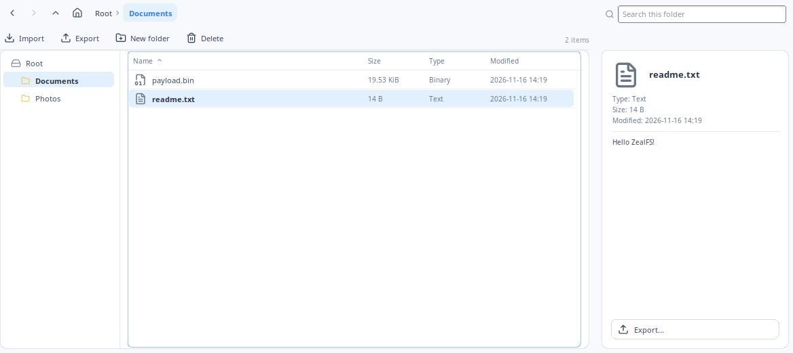

# Using the GUI

[README](../README.md) · [CLI guide](CLI.md) · [ZealFS concepts](ZEALFS.md) · [Disk operations](DISKS.md) · [Build/install](BUILD.md)

The GUI is a single-window FLTK application with a native title bar, a classic
menu bar, a disk sidebar, a partition map, a details/action panel and an
embedded file browser.
Start `zeal_disk_tool` (`zeal_disk_tool.exe` on Windows), or open the macOS
`ZealDiskTool.app` package. A source build can launch one or more images
directly:

```sh
./build/default/zeal_disk_tool disk.img
./build/default/zeal_disk_tool disk.img other.img
```

Startup image arguments must have an `.img` extension. `zeal_disk_tool -h`
prints its startup options; Windows also supports `-g` to allocate a console
window. See [build and installation](BUILD.md) for binaries and dependencies,
and [physical device access](DISKS.md#physical-device-access) if working with a
card rather than an image.


## Window layout

- **Menu bar** — **File**, **Disk**, **Edit** and **Help**, using the native
  window frame for moving, resizing and minimizing.
- **File** — open or create an image, apply or discard pending changes, quit.
- **Disk** — refresh devices, create a partition or MBR, format, delete or
  inspect the selected partition.
- **Edit** — import, export, create folders and delete entries in the file
  browser, plus focus and search shortcuts.
- **Help** — keyboard shortcuts and the About box.
- **Heading** — the selected disk's name and its size, layout and slot usage,
  with the **Apply changes** button on the right. The button is enabled while
  that disk has pending changes and writes them, like **File → Apply Changes**
  or `Ctrl+S`.
- **Disks sidebar** — every discovered disk and its partitions. Clicking a disk
  header shows that disk's overview, while clicking a partition row selects it;
  the disk header is highlighted only in the overview. The **+** button opens a
  menu for new partitions, images and MBR tables. Disks with unsaved changes
  show an amber dot.
- **Disk map** — proportional coloured segments for the selected disk; click a
  segment to select its partition.
- **Partition details** — filesystem, total/used/free space, start address,
  slot, type byte and staged state, with **Format**, **Delete** and
  **Properties** actions. In the disk overview it instead lists every partition
  of the disk (click a row to select it) with the disk's size, layout and slot
  usage.
- **File browser** — breadcrumb navigation, a collapsible folder tree (use the
  chevron to expand or collapse a folder), sortable file list, search field and
  a details/preview card. It follows the selected partition and is inactive
  while the disk overview is shown.
- **Status bar** — the latest operation result and the unsaved-changes badge.

## Open an image or select a card

Use the sidebar **+** button, **File → Open Image...**, or `Ctrl+O`. Accessible
physical disks appear in the sidebar automatically; after inserting a card use
**Disk → Refresh Devices** or `F5`. Apply or cancel pending changes before
refreshing or switching targets. If a card is missing,
follow the shared
[device-discovery troubleshooting](DISKS.md#a-card-is-missing-from-the-device-list).

Click a disk header in the sidebar to open that disk's overview: the map still
shows all of its partitions and the details card lists them, but no partition is
selected and the file browser stays inactive until you pick one. Click a
partition row in the sidebar, a row in the overview or a map segment to select
it. Opening or refreshing a disk selects its first usable partition. GUI
partition labels are 0–3; see the
[CLI number mapping](ZEALFS.md#disk-partition-and-filesystem) when switching
between interfaces.

## Create an image and partition

1. Open **File → Create Image...** (or `Ctrl+N`).
2. Set **Location** directly or with **Browse...**, and select a **Size**
   preset.
3. Choose **Table: MBR** for a partitioned image, or **None** for a raw
   filesystem image. See
   [disk layouts](ZEALFS.md#disk-partition-and-filesystem) before choosing.
4. Click **Create**. The image is staged and selected; its host file is not
   created yet.
5. Choose **Disk → New Partition...**, or use `Ctrl+P`.
6. Set the **Size** with the field or slider and choose its unit (KiB or MiB).
   Choose the **Alignment** (512 bytes or 1 MiB) and review the **Address**
   where the partition will start.
7. Click **Create**. The new partition is formatted as ZealFS v2 and can be
   selected and browsed before saving.
8. Repeat steps 5–7 for up to four partitions, then press **Apply** and confirm
   to publish the image and its contents.

The new partition dialog starts with the largest free block and shows the
resulting address. Partition slots, capacity and alignment follow the
[shared ZealFS limits](ZEALFS.md#capacity-and-allocation). Creating another
partition does not resize or move an existing one; up to four partitions can be
staged before Apply.

**Disk → Create MBR** stages an MBR partition table on an eligible target
without one. It does not convert an existing raw filesystem into a partitioned
disk.

## Browse and manage files

The file browser is embedded below the partition details and follows the
selected ZealFS partition. Selecting another partition reloads the browser at
its root directory.



- Double-click a folder in the list to open it.
- Use the breadcrumb chips or the back/forward/up/home buttons to navigate.
- Click a folder in the tree to jump to it; click its chevron to collapse or
  expand its children.
- Hover navigation, action and tree items to see tooltips.
- Click a column header (**Name**, **Size**, **Type**, **Modified**) to sort;
  click it again to reverse the order.
- Type in the search field to filter the current folder; clear the text or
  press `Esc`.
- Click a file to preview it in the details card. Double-click a file to export
  it.
- Click a row to select it. `Ctrl`-click (`Command`-click on macOS) toggles
  individual entries, `Shift`-click selects a range, and `Ctrl+A` selects every
  entry in the current folder. The details card summarises the selection, and
  **Delete** and **Export** act on all selected entries.

### Import files

Use **Edit → Import Files...** (or the **Import** button above the file list) and
select one or more host files. Files
are added to the directory currently shown. If a host filename exceeds 16
bytes, a dialog asks for a shorter name; the host file itself is not renamed.

Imports are staged, and matching destination filenames are refused rather than
replaced. If a later file fails during a multi-file import, earlier successful
imports remain staged. Check the status bar and the list before choosing Apply
or Cancel.

Drag files or folders from the host file manager and drop them on the file list
to import without the file dialog; the browsing area is outlined while a drop is
possible. Dropped folders are imported recursively, preserving their structure;
a folder that already exists is merged. Entries that break the 16-byte name
limit are skipped and reported in the status bar. File drag-and-drop depends on
the desktop's native drag support and is not available from every file manager.

### Export a file or folder

Select a file or folder, then use **Edit → Export Selection...**, the **Export**
button in the file action row, or the **Export...** button in the preview card. Choose its destination in the save
dialog. Export writes the host file immediately and can read staged contents;
it does not need Apply. Selecting a folder exports its contents recursively into
the chosen host location. With several entries selected, the dialog asks for a
destination folder and each entry is exported into it; failures are counted in
the status bar.

The distinction between an export and a raw recovery image is explained in
[copies and backups](DISKS.md#import-export-and-backups). For CLI export of the
whole filesystem, see [CLI export](CLI.md#export-files-and-directories).

### Create or delete entries

Use **Edit → New Folder...** (or the **New folder** button), enter a name within
the 16-byte limit, and confirm. The
directory is created inside the directory currently shown and remains staged.

Select a file or empty directory and use **Edit → Delete...** (or the **Delete**
button); confirm the prompt to stage its removal. A nonempty directory cannot be
deleted recursively. The file browser's **Delete** is separate from **Disk →
Delete Partition...** and the partition **Delete** action in the details panel.

## Format or delete a partition

Select the target partition in the sidebar or map.

- **Format** in the details panel (or **Disk → Format Partition...**) stages a
  fresh ZealFS v2 filesystem in that partition, replacing its old filesystem
  and files when applied.
- **Delete** (**Disk → Delete Partition...**) stages removal of the selected
  partition.

**Properties** opens a summary of the disk and selected partition. Inspect the
selection before Apply. **File → Discard Changes** drops all pending changes for
that target, including file and partition edits made in the same session.

## Save, discard and quit

An asterisk (`*`) in the window title, the amber dot in the sidebar and the
**Unsaved changes** badge indicate pending changes.

| Control | Action |
| --- | --- |
| **File → Apply Changes** / `Ctrl+S` | Ask for confirmation, then write all pending changes for the selected disk |
| **File → Discard Changes** | Ask whether to discard all pending changes for the selected disk |
| **File → Quit** / window close / `Ctrl+Q` | For each target with pending work, offer Apply, Discard or Keep editing |

Cancelling an operation's dialog only dismisses that dialog. **Cancel** discards
the target's entire pending set. Discarding a newly created image removes its
unpublished session without creating a host file.

See [Apply and discard](DISKS.md#apply-and-discard) for how image replacement
differs from writing a physical card. Errors and operation results appear in the
status bar, with dialogs for some operations. After a physical write failure,
close and reopen the target before attempting recovery.

## Keyboard shortcuts

| Shortcut | Action |
| --- | --- |
| `Ctrl+O` | Open a disk image |
| `Ctrl+N` | Create a disk image |
| `Ctrl+P` | Create a partition |
| `Ctrl+I` | Import host files into the current folder |
| `Ctrl+E` | Export the selected file or folder |
| `Ctrl+B` | Focus the file browser |
| `Ctrl+F` | Focus the search field |
| `Ctrl+A` | Select every entry in the current folder |
| `Shift+Up` / `Shift+Down` | Extend the file selection |
| `Ctrl`-click / `Shift`-click | Toggle an entry / select a range |
| `F5` | Refresh devices |
| `Delete` | Delete the selected entries in the file browser, or the selected partition elsewhere |
| `Ctrl+S` | Apply pending changes |
| `Ctrl+Q` | Quit |

On macOS, FLTK maps the command shortcuts to Command.

## Application icon

The window uses the native title bar. Its 32×32 icon is embedded in the binary
and set as `_NET_WM_ICON`; the window class is `zeal-disk-tool`, matching
`packages/appdir/zeal-disk-tool.desktop`. Desktop shells use the `.desktop`
entry and icon-theme artwork for the dock, Alt-Tab and window lists. Packaged
builds provide both. For a local build, install
`packages/appdir/zeal-disk-tool.desktop` and the icons from `packages/icons/`
with an `Exec` line pointing at the built binary to make the dock icon appear.

## Updating existing software

The GUI can import individual new files. Updating matching files while
preserving personal files, creating raw partition backups during that update,
and restoring those backups are available through
[CLI merge and restore](CLI.md#merge-updates-from-an-image-or-device). Resolve
pending GUI changes and close its target session before accessing the same
target through another process.
