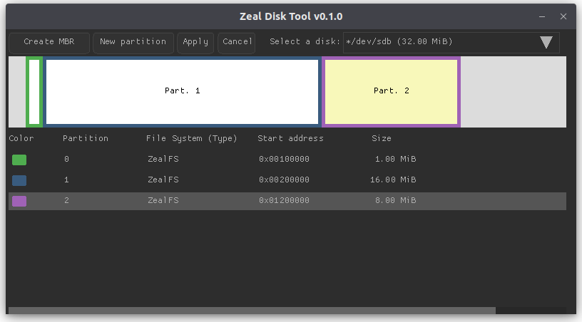

# Using the GUI

[README](../README.md) · [CLI guide](CLI.md) · [ZealFS concepts](ZEALFS.md) · [Disk operations](DISKS.md) · [Build/install](BUILD.md)

The GUI manages images and physical disks through a partition view and file browser. Start `zeal_disk_tool` (`zeal_disk_tool.exe` on Windows), or open the macOS `ZealDiskTool.app` package. A source build can launch an image directly:

```sh
./build/default/zeal_disk_tool disk.img
```

The startup image argument must have an `.img` extension. `zeal_disk_tool -h` prints its startup options; Windows also supports `-g` to allocate a console window. See [build and installation](BUILD.md) for binaries and dependencies, and [physical device access](DISKS.md#physical-device-access) if working with a card rather than an image.



## Open an image or select a card

Choose **File → Open image...**, or **Open image file...** in the **Select a disk** dropdown. Select the image to make it the current target.

Accessible physical disks also appear in the dropdown. After inserting a card, use **File → Refresh devices**. Apply or cancel pending changes before refreshing or switching targets. If a card is missing, follow the shared [device-discovery troubleshooting](DISKS.md#a-card-is-missing-from-the-device-list).

The **Disk partitioning** area shows a diagram and a partition table. Click a partition's table row to select it. Its filesystem type, starting byte address and size are displayed. The right-hand **Partition viewer** opens only for a ZealFS partition. GUI partition labels are 0–3; see the [CLI number mapping](ZEALFS.md#disk-partition-and-filesystem) when switching between interfaces.

## Create an image and partition

1. Choose **File → Create image...**.
2. Set **Location** directly or with **Browse...**, and select a **Size** preset.
3. Choose **Table: MBR** for a partitioned image, or **None** for a raw filesystem image. See [disk layouts](ZEALFS.md#disk-partition-and-filesystem) before choosing.
4. Click **Create**. The image is staged and selected; its host file is not created yet.
5. Click **New partition**, or choose **Partition → New**.
6. Set **Size** in KiB/MiB using the field or slider, choose **Alignment** (512 bytes or 1 MiB), and review the displayed starting **Address**.
7. Click **Create**. The new partition is formatted as ZealFS v2 and can be selected and browsed before saving.
8. Click **Apply** and confirm to publish the image and its contents.

The new partition dialog starts with the available maximum size. Partition slots, capacity and alignment follow the [shared ZealFS limits](ZEALFS.md#capacity-and-allocation). Creating another partition does not resize or move an existing one.

**Create MBR**, also available under **Partition → Create MBR**, stages an MBR on an eligible target without one. It does not convert an existing raw filesystem into a partitioned disk.

## Browse and manage files

Select a ZealFS partition in the table. The **Partition viewer** lists each entry's name, byte size, type and date, with a usage display below.

- Double-click a directory to open it.
- Click **Up** to return to its parent.
- Enter a filesystem directory path in the address bar, then click **Go** or press Enter. Use `/` for the root.
- Select an entry before using **Export** or **Delete**.

The viewer includes staged content. After changes, the usage display reflects the current staged filesystem. For path/name rules and what free space means, see [ZealFS concepts](ZEALFS.md).

### Import files

Click **Import** and select one or more host files. Files are added to the directory currently shown. If a host filename exceeds 16 bytes, a **Rename File** dialog asks for a shorter name; the host file itself is not renamed.

Imports are staged, and matching destination filenames are refused rather than replaced. If a later file fails during a multi-file import, earlier successful imports remain staged. Check the status bar and browser before choosing Apply or Cancel. Host directories are not imported recursively.

### Export a file

Select a file and click **Export**, or double-click the file. Choose its destination in the save dialog. Export writes the host file immediately and can read staged contents; it does not need Apply. The save dialog handles choosing an existing destination, which the export operation may replace.

The GUI exports individual files. To export a directory or the whole filesystem recursively, use [CLI directory export](CLI.md#export-files-and-directories). The distinction between an export and a raw recovery image is explained in [copies and backups](DISKS.md#import-export-and-backups).

### Create or delete entries

Click **New dir**, enter a name within the 16-byte limit, and confirm. The directory is created inside the directory currently shown and remains staged.

Select a file or empty directory and click **Delete** to stage its removal. A nonempty directory cannot be deleted recursively. The file browser's **Delete** is separate from the **Delete partition** control in the disk partitioning area.

## Format or delete a partition

Select the target partition in the partition table.

- **Partition → Format** stages a fresh ZealFS v2 filesystem in that partition, replacing its old filesystem and files when applied.
- **Delete partition** or **Partition → Delete** stages removal of that partition.

Inspect the selected disk and partition before Apply. **Cancel** discards all pending changes for that target, including other file or partition edits made in the same session.

## Save, discard and quit

An asterisk (`*`) in the selected disk label indicates pending changes.

| Control | Action |
| --- | --- |
| **Apply** / **File → Apply changes** | Ask for confirmation, then write all pending changes for the selected disk |
| **Cancel** / **File → Cancel changes** | Ask whether to discard all pending changes for the selected disk |
| **File → Quit** / window close | For each target with pending work, offer Yes to apply, No to discard, or Cancel to keep editing |

Cancelling an operation's dialog only dismisses that dialog. The main **Cancel** control discards the target's entire pending set. Discarding a newly created image removes its unpublished session without creating a host file.

See [Apply and discard](DISKS.md#apply-and-discard) for how image replacement differs from writing a physical card. Errors and operation results appear in the status bar, with dialogs for some operations. After a physical write failure, close and reopen the target before attempting recovery.

## Updating existing software

The GUI can import individual new files. Updating matching files while preserving personal files, creating raw partition backups during that update, and restoring those backups are available through [CLI merge and restore](CLI.md#merge-updates-from-an-image-or-device). Resolve pending GUI changes and close its target session before accessing the same target through another process.
