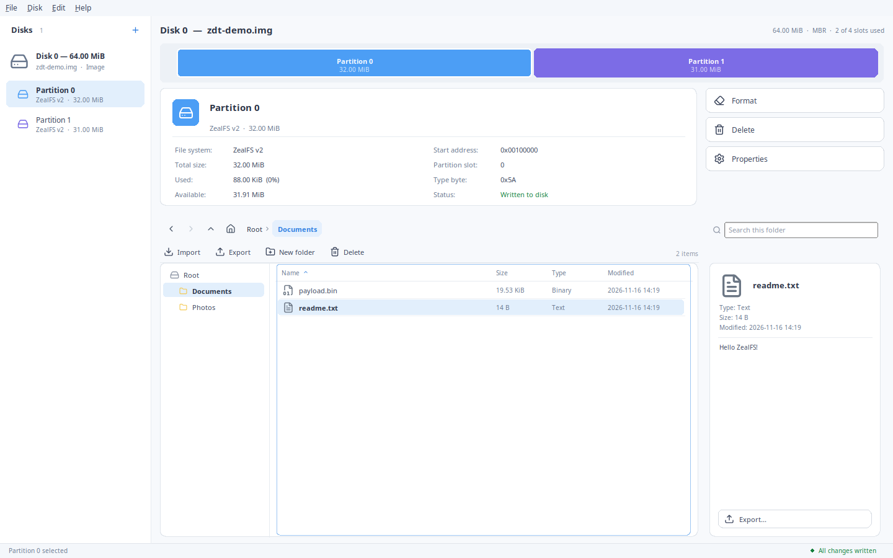

# Using the GUI

[README](../README.md) · [CLI guide](CLI.md) · [ZealFS concepts](ZEALFS.md) · [Disk operations](DISKS.md) · [Build/install](BUILD.md)

The GUI manages images and physical disks through a partition map, a partition table and a separate file browser window. It is built with FLTK. Start `zeal_disk_tool` (`zeal_disk_tool.exe` on Windows), or open the macOS `ZealDiskTool.app` package. A source build can launch one or more images directly:

```sh
./build/default/zeal_disk_tool disk.img
./build/default/zeal_disk_tool disk.img other.img
```

Startup image arguments must have an `.img` extension. `zeal_disk_tool -h` prints its startup options; Windows also supports `-g` to allocate a console window. See [build and installation](BUILD.md) for binaries and dependencies, and [physical device access](DISKS.md#physical-device-access) if working with a card rather than an image.



## Open an image or select a card

Choose **File → Open image...** (`Ctrl+O`), or **Open image file...** in the disk dropdown. Select the image to make it the current target.

Accessible physical disks also appear in the dropdown. After inserting a card, use **File → Refresh devices** (`F5`). Apply or cancel pending changes before refreshing or switching targets. If a card is missing, follow the shared [device-discovery troubleshooting](DISKS.md#a-card-is-missing-from-the-device-list).

The main window shows the selected disk as a proportional partition map and a partition table. Click a partition in either place to select it; the right-hand panel shows its filesystem type, starting byte address, size, usage and whether it has pending changes. The **Disk** section below shows the target name, capacity and slot usage. GUI partition labels are 0–3; see the [CLI number mapping](ZEALFS.md#disk-partition-and-filesystem) when switching between interfaces.

## Create an image and partition

1. Choose **File → Create image...** (`Ctrl+N`).
2. Set **Location** directly or with **Browse...**, and select a **Size** preset.
3. Choose **Table: MBR** for a partitioned image, or **None** for a raw filesystem image. See [disk layouts](ZEALFS.md#disk-partition-and-filesystem) before choosing.
4. Click **Create**. The image is staged and selected; its host file is not created yet.
5. Click **New partition**, or choose **Partition → New partition** (`Ctrl+P`).
6. Set the **Size** with the field or slider and choose its unit (KiB or MiB). Choose the **Alignment** (512 bytes or 1 MiB) and review the **Address** where the partition will start.
7. Click **Create**. The new partition is formatted as ZealFS v2 and can be selected and browsed before saving.
8. Repeat steps 5–7 for up to four partitions, then click **Apply** and confirm to publish the image and its contents.

The new partition dialog starts with the largest free block and shows the resulting address. Partition slots, capacity and alignment follow the [shared ZealFS limits](ZEALFS.md#capacity-and-allocation). Creating another partition does not resize or move an existing one; up to four partitions can be staged before Apply.

**Create MBR**, also available under **Partition → Create MBR**, stages an MBR on an eligible target without one. It does not convert an existing raw filesystem into a partitioned disk.

## Browse and manage files

Select a ZealFS partition, then click **Browse files...** in the details panel, double-click the partition, or press `Ctrl+B`. The **Files** window is a separate, resizable window; it follows the partition selected in the main window, so switching partitions retargets it. Closing the Files window leaves the disk view open.


The Files window lists each entry's name, size, type and modification date, with the partition usage below.

- Double-click a folder to open it.
- Click **Up** to return to its parent.
- Enter a filesystem directory path in the path bar, then click **Go** or press Enter. Use `/` for the root.
- Click a column header (**Name**, **Size**, **Type**, **Modified**) to sort; click it again to reverse the order.
- Select an entry before using **Export...** or **Delete**.

The browser includes staged content. After changes, the usage bar and entry count reflect the current staged filesystem. For path/name rules and what free space means, see [ZealFS concepts](ZEALFS.md).

### Import files

Click **Import files...** and select one or more host files. Files are added to the directory currently shown. If a host filename exceeds 16 bytes, a dialog asks for a shorter name; the host file itself is not renamed.

Imports are staged, and matching destination filenames are refused rather than replaced. If a later file fails during a multi-file import, earlier successful imports remain staged. Check the status bar and browser before choosing Apply or Cancel. Host directories are not imported recursively.

### Export a file or folder

Select a file or folder and click **Export...**, or double-click a file. Choose its destination in the save dialog. Export writes the host file immediately and can read staged contents; it does not need Apply. The save dialog handles choosing an existing destination, which the export operation may replace.

Selecting a folder exports its contents recursively into the chosen host location. To export a single file from the command line, or the whole filesystem, use [CLI export](CLI.md#export-files-and-directories). The distinction between an export and a raw recovery image is explained in [copies and backups](DISKS.md#import-export-and-backups).

### Create or delete entries

Click **New folder**, enter a name within the 16-byte limit, and confirm. The directory is created inside the directory currently shown and remains staged.

Select a file or empty directory and click **Delete**; confirm the prompt to stage its removal. A nonempty directory cannot be deleted recursively. The file browser's **Delete** is separate from the **Delete** control in the disk partitioning toolbar.

## Format or delete a partition

Select the target partition in the map or table.

- **Format** (or **Partition → Format partition**) stages a fresh ZealFS v2 filesystem in that partition, replacing its old filesystem and files when applied.
- **Delete** (or **Partition → Delete partition**) stages removal of that partition.

Inspect the selected disk and partition before Apply. **Cancel** discards all pending changes for that target, including other file or partition edits made in the same session.

## Save, discard and quit

An asterisk (`*`) in the disk dropdown label and the orange **UNSAVED CHANGES** badge indicate pending changes.

| Control | Action |
| --- | --- |
| **Apply** / **File → Apply changes** (`Ctrl+S`) | Ask for confirmation, then write all pending changes for the selected disk |
| **Cancel** / **File → Cancel changes** | Ask whether to discard all pending changes for the selected disk |
| **File → Quit** (`Ctrl+Q`) / window close | For each target with pending work, offer Apply, Discard or Keep editing |

Cancelling an operation's dialog only dismisses that dialog. The main **Cancel** control discards the target's entire pending set. Discarding a newly created image removes its unpublished session without creating a host file. Quitting closes the Files window as well.

See [Apply and discard](DISKS.md#apply-and-discard) for how image replacement differs from writing a physical card. Errors and operation results appear in the status bar, with dialogs for some operations. After a physical write failure, close and reopen the target before attempting recovery.

## Keyboard shortcuts

| Shortcut | Action |
| --- | --- |
| `Ctrl+O` | Open a disk image |
| `Ctrl+N` | Create a disk image |
| `F5` | Refresh devices |
| `Ctrl+P` | Create a partition |
| `Ctrl+B` | Open the file browser for the selected ZealFS partition |
| `Delete` | Delete the selected partition |
| `Ctrl+S` | Apply pending changes |
| `Ctrl+Q` | Quit |

On macOS, FLTK maps the command shortcuts to Command. Shortcuts belong to the focused window; the disk view owns the menu bar.

## Application icon

The GUI installs a 32×32 `_NET_WM_ICON` and uses the window class
`zeal-disk-tool` (matching `packages/appdir/zeal-disk-tool.desktop`). GNOME/Mutter
does not draw application icons inside window title bars; the icon appears in
the dock, Alt-Tab and window lists when the matching `.desktop` file and
`zeal-disk-tool` icon are installed. Packaged builds provide both. A local build
also sets the icon on its windows, but without an installed desktop entry the
desktop shell may show a generic icon for it.

## Updating existing software

The GUI can import individual new files. Updating matching files while preserving personal files, creating raw partition backups during that update, and restoring those backups are available through [CLI merge and restore](CLI.md#merge-updates-from-an-image-or-device). Resolve pending GUI changes and close its target session before accessing the same target through another process.
